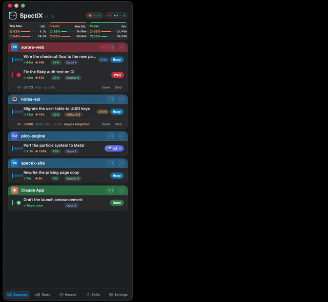
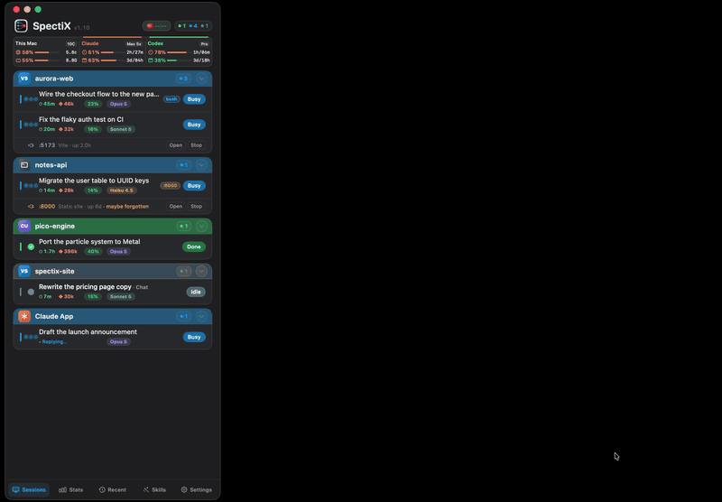
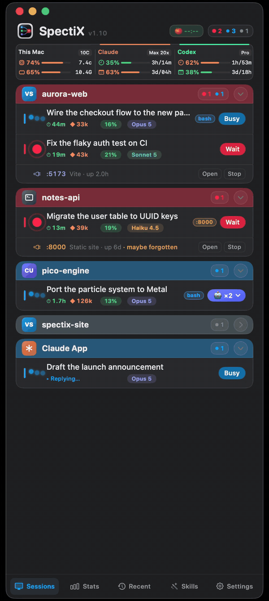
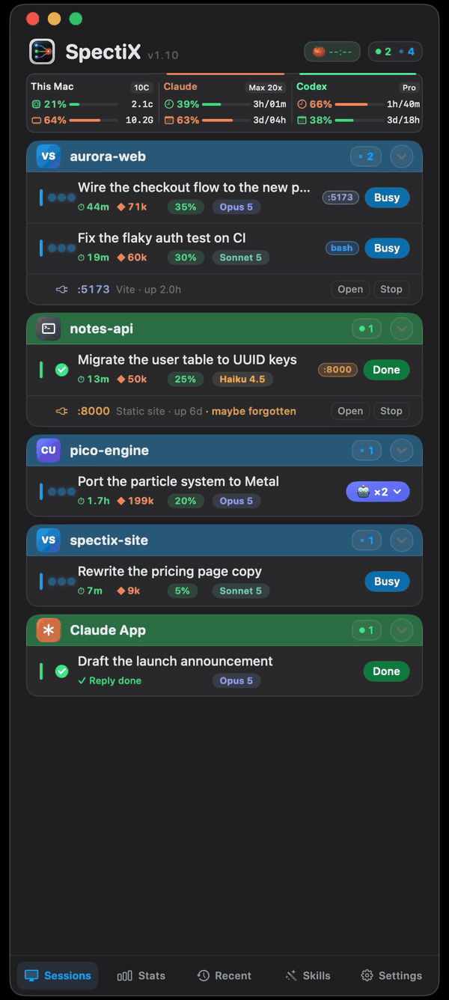
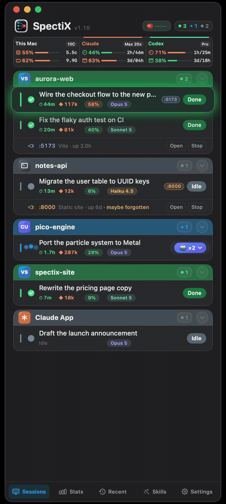
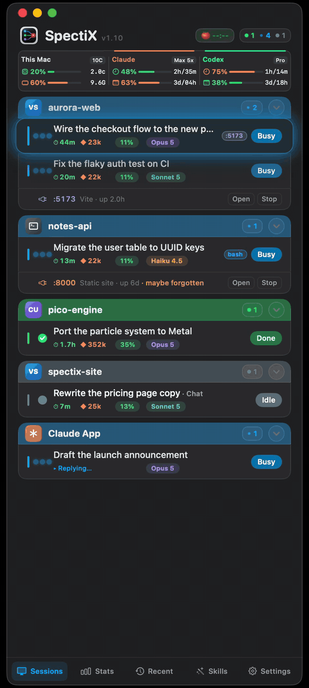

# SpectiX

[](https://spectix.app)
[](LICENSE)

**See which Claude Code or Codex session is waiting for you, and click straight to its terminal.**

Run five sessions at once and one of them is always sitting on a permission prompt you haven't seen. SpectiX lives in the menu bar, puts the sessions that need you at the top, and takes you to the exact terminal — down to the pane inside VS Code — in one click.


**[Download for macOS](https://spectix.app)** · free · notarized installer · [▶ 97-second tour](https://spectix.app/assets/spectix-tour.mp4)

## See it in action

**One click to the right terminal.** Terminal, iTerm2, VS Code, Cursor or Windsurf comes to the front, ringed in the session's status colour so you see where you landed.

<p align="center">
  
</p>

**The exact pane inside VS Code.** With several terminals in one window, SpectiX switches to the one that session runs in.

<p align="center">
  
</p>

**A tap on the shoulder when it needs you.** A toast appears when a session finishes or needs you; `⌃⌥⌘N` jumps to the next one waiting, from anywhere.

<p align="center">
  
</p>

## Also in the menu bar

<table>
  <tr>
    <td width="50%" valign="top">
      <br>
      <b>Every session, live</b> — grouped by project, with time, tokens, context used and model.
    </td>
    <td width="50%" valign="top">
      <br>
      <b>Quota at a glance</b> — Claude and Codex 5-hour and weekly limits with reset countdowns, plus CPU and memory.
    </td>
  </tr>
  <tr>
    <td width="50%" valign="top">
      <br>
      <b>Switch accounts</b> without signing in again; new terminals use the one you pick.
    </td>
    <td width="50%" valign="top">
      <br>
      <b>Stats, recent projects and skills</b> — today's activity, one-click reopen, and how often each skill is used.
    </td>
  </tr>
</table>

Plus **quick actions**: one-click tiles for your own scripts, Claude skills or prompts, which your AI can add for you, and **project groups** for features that span several repositories.

<p align="center">
  <a href="https://spectix.app/assets/spectix-tour.mp4">
    
  </a>
  <br>
  <a href="https://spectix.app/assets/spectix-tour.mp4">▶ Watch the 97-second tour (with sound)</a>
</p>

## Install

Download the installer from **[spectix.app](https://spectix.app)**, open `Install SpectiX.app` and click Install. It places the app, the Claude Code / Codex hooks and the companion VS Code extension. Requires macOS 13 or later.

On first jump macOS asks for **Accessibility** — the only permission SpectiX needs. It uses it to raise the target window and find the right terminal pane. Screen Recording is never requested.

What changed in each release: [CHANGELOG.md](CHANGELOG.md).

## Privacy: no network

The SpectiX app binary opens no network connection, and the build enforces it: `build.sh` refuses to compile if any networking API appears in the sources, or if the linked binary pulls in a network library. Two opt-in features reach the network through a separate `curl` process, only when you ask — Apple Watch push via Bark (off until you enter a key) and the account panel's refresh button.

Check it yourself:

```bash
otool -L "/Applications/SpectiX.app/Contents/MacOS/SpectiX"   # no CFNetwork, Network.framework, libcurl, libssl
lsof -i -a -p $(pgrep -x SpectiX)                            # no output while running
```

Full details: [spectix.app/privacy](https://spectix.app/privacy).

## How it works

Claude Code and Codex hooks call `hooks/spectix-status.sh` on each event. It finds the session's terminal (tty) and writes a plain-text state file to `~/.claude/spectix/`. The app reads those files for every live session and fills the hooks' blind spots from the process tree. Details (in Chinese): [docs/session-status.md](docs/session-status.md).

## Build from source

Needs macOS 13+ and the Xcode Command Line Tools.

```bash
git clone https://github.com/spectix-app/SpectiX.git && cd SpectiX
./tools/setup-signing-cert.sh   # optional, keeps the Accessibility grant across rebuilds
./build.sh && open "SpectiX Dev.app"
```

Then wire the hooks with `/plugin marketplace add spectix-app/SpectiX` and `/plugin install spectix@spectix` inside Claude Code (or by hand, see [plugin/README.md](plugin/README.md)), and run `./vscode-extension/install.sh` for pane-level jumps in VS Code.

## License

Source-available under the Functional Source License ([FSL-1.1-ALv2](LICENSE)): free to use, personally or at work; you may not sell it or ship a competing product built from it. Each release becomes Apache-2.0 two years after it ships. Versions 1.9 and earlier were GPL-3.0. The "SpectiX" name and logo are not licensed for forks.

Pull requests are closed without review, but bug reports and ideas are very welcome as [issues](https://github.com/spectix-app/SpectiX/issues/new/choose) — see [CONTRIBUTING.md](CONTRIBUTING.md). Security issues: [SECURITY.md](SECURITY.md).

The two break-reminder photos are used under the [Pexels License](https://www.pexels.com/license/): [Tamba Budiarsana](https://www.pexels.com/photo/979247/) (`tools/cat-stretch.jpg`) and [Pet foto](https://www.pexels.com/photo/17753986/) (`tools/cat-glasses.jpg`).

SpectiX is an independent project by SpectiX Lab, not affiliated with Anthropic or OpenAI. Claude and Claude Code are trademarks of Anthropic, PBC; Codex is a trademark of OpenAI.
